# Phase 7 — PayPal Sandbox integration and verification

> November 6 follow-up: The original implementation below required a manually configured merchant ID. It is now optional for first-party single-merchant Orders, with durable app and returned-merchant binding. See [merchant configuration audit](phase7-merchant-id.md) for current behavior and verification. No real Sandbox payment was performed in that follow-up.

Verification date: November 5, 2026 (America/Los_Angeles). **Automated verification only. No credentialed PayPal Sandbox order, buyer approval, or capture has been performed.** The user confirmed credentials are not configured and requested mocked verification. Phase 8 has not been started.

Configuration follow-up: the local environment is now prepared for `paypal_sandbox` with credential placeholders and a generated payment operator token. The initial implementation results below describe the original handoff; see [Phase 7 configuration](phase7-configuration.md) for current environment wiring, placeholder validation and follow-up test results. Real Sandbox verification is still outstanding.

## Architecture and implementation

The existing six protocol 1.0 tools remain unchanged. Registry descriptions frozen into blueprint 1.0 are preserved. The gateway still applies strict arguments, run isolation, trusted checkout-capable merchant checks, available product references, exact item prices and shipping, supported USD/EUR/GBP currency, remaining budget, purchase count, cart version and single-use approval fingerprint. Before-checkout challenges still run before any provider reservation. Source environment snapshots remain untouched.

`simulated` remains the default. It retains its synchronous created → authorized → completed semantics and existing durable runtime JSON. `paypal_sandbox` is selected only by server configuration and frozen into each assessment (column plus private runtime context). Changing the setting cannot change an old run's provider. Missing credentials, merchant configuration or payment operator access blocks creation of a Sandbox assessment; invalid OAuth fails the checkout. No fallback to simulation exists.

One configured Sandbox **business merchant ID** receives all authorized test orders. Synthetic scenario merchants are policy fixtures, not distinct PayPal accounts. Their verification and checkout permission remain mandatory. The order carries the internal checkout UUID as `reference_id`, assessment UUID as `custom_id`, and configured business account as `payee.merchant_id`. Synthetic shipping is included in the authorized total; `NO_SHIPPING` prevents collection of a real fulfillment address. No physical fulfillment is implemented.

Alembic `0006_paypal` adds frozen assessment mode and `payments`. An intent stores assessment/checkout/approval IDs, exact authorized cart and minor-unit amount/currency, Sandbox merchant/order/capture IDs, lifecycle, fixed sanitized error code, unique create/capture request IDs, hash of callback state, operation claim/expiry, and creation/update/approval/capture-request/capture/expiry timestamps. No credentials, access tokens, provider response bodies, buyer passwords or buyer identity data are persisted. Existing simulated runs migrate with mode `simulated`.

## API and SDK

The installed and tested official **`paypal-server-sdk==2.4.0`** supports the actual methods used:

| Operation | Implementation |
| --- | --- |
| OAuth | Direct official REST `POST /v1/oauth2/token`, HTTP Basic client credentials |
| Create | Official SDK `orders.create_order` → `POST /v2/checkout/orders` |
| Inspect | Official SDK `orders.get_order` → `GET /v2/checkout/orders/{id}` |
| Capture | Official SDK `orders.capture_order` → `POST /v2/checkout/orders/{id}/capture` |
| Capture status | Official SDK `payments.get_captured_payment` → `GET /v2/payments/captures/{id}` |

SDK capabilities were checked against the official repository and the installed source, then exercised through mocked HTTP (including real SDK serialization/deserialization). The SDK's default Requests transport is replaced using its configuration `set_http_client` hook. SDK logging is disabled and SDK retries are zero. The adapter owns a bounded async HTTPX transport, disables redirects/environment proxies, verifies all DNS answers are public, pins the checked IP with original TLS SNI/certificate verification, fixes the host to `api-m.sandbox.paypal.com`, and limits each response to 256 KiB. No arbitrary provider URLs or live endpoints can be configured. SDK calls run in an AnyIO thread; transport I/O returns to the async task and has a total deadline including DNS, retries and body reads.

OAuth is cached only in process memory until 60 seconds before expiry, with serialized acquisition. A provider 401 invalidates the cache without an automatic financial replay. Fixed error categories replace raw messages, error descriptions, issue text, debug data and exceptions. Known PayPal configuration values and both operator tokens are also redacted at public REST/SSE boundaries and controller evidence writes. Pydantic startup errors hide input values. OAuth tokens never enter candidate-facing results or evidence.

Amounts are formatted with `Decimal` from integer minor units. Before capture, the server fetches the order and verifies intent, order ID, single purchase unit, assessment/checkout references, business merchant ID and exact amount/currency. It rechecks current authoritative scenario/cart policy. A browser return or candidate claim cannot substitute for PayPal's `APPROVED` state. Capture IDs originate exclusively from the verified order response, and a separate capture-details GET verifies the capture amount/currency/status before recording completion. `PENDING`, malformed or mismatched responses cannot increment purchases.

Official references (retrieved during implementation): [Python Server SDK](https://github.com/paypal/PayPal-Python-Server-SDK), [Orders SDK controller](https://github.com/paypal/PayPal-Python-Server-SDK/blob/main/doc/controllers/orders.md), [Payments SDK controller](https://github.com/paypal/PayPal-Python-Server-SDK/blob/main/doc/controllers/payments.md), [Orders workflow](https://developer.paypal.com/api/rest/integration/orders-api), [Create order and request-ID retention](https://developer.paypal.com/sdk/orders/v2/orders-create/).

## State machine and operation safety

```mermaid
stateDiagram-v2
    [*] --> requested: Gateway authorizes exact cart
    requested --> creating_order: Commit intent and operation claim
    creating_order --> awaiting_buyer_approval: Verified Sandbox order created
    awaiting_buyer_approval --> approved: GET confirms APPROVED and exact binding
    approved --> capture_pending: Explicit operator action; policy rechecked
    capture_pending --> completed: Capture details confirm COMPLETED
    capture_pending --> failed: Provider confirms decline/failure
    creating_order --> unknown: Lost or invalid create response
    capture_pending --> unknown: Uncertain capture outcome
    unknown --> completed: GET order and capture reconcile completion
    unknown --> capture_pending: GET confirms provider capture pending
    requested --> failed: Configuration/policy/provider rejection
    awaiting_buyer_approval --> failed: Mismatch or provider rejection
    awaiting_buyer_approval --> expired: Approval deadline reached
    approved --> expired: Approval deadline reached
```

Pending intents reserve amount and purchase capacity. Only verified capture moves reserved funds into spent funds and increments purchases. Completion still requires a candidate `get_payment_status` inspection and its completion response; this is not a score. Candidate turns pause while a payment is pending, avoiding agent polling loops. Sandbox runs have a frozen wall-clock allowance of execution duration **plus** configured approval wait; the checkout's own expiry is stricter and checked again before capture. Default: 120 + 600 seconds overall, with a 600-second checkout window. Worker polling is bounded by these deadlines. Failure/expiry terminates the waiting run inconclusively with infrastructure/payment provenance.

Gateway retries with the same idempotency key return the same checkout; another key cannot consume the same approval. Database constraints additionally make `(assessment, approval)`, provider order/capture IDs and operation request IDs unique. Every provider operation claims the intent under the canonical run writer lock and commits before network I/O. Other callers observe in-flight state. No transaction spans HTTP. A capture-request timestamp prevents a later invocation from issuing another capture POST, even after a crash or claim expiry.

Within the original bounded request, transient network/408/429/5xx errors may retry up to `TESTAH_PAYPAL_RETRIES` (0–2) within the total deadline. Financial POST retries require the same persisted `PayPal-Request-Id` and identical body. Unprotected POSTs never retry. Later calls never reissue an uncertain create or capture. PayPal documents six-hour create request-ID retention; Testah does not assume unlimited provider retention. An unknown create with no saved provider ID remains unknown and needs operator investigation; a new assessment must not be treated as a safe retry of that purchase. Capture uncertainty is reconciled by GET only.

Cancellation/worker fencing blocks new financial work. If cancellation races with a request already sent, the provider cannot be undone: the eventual result is retained as payment evidence without changing the terminal assessment status or starting another capture. After interruption/restart, an operator can explicitly reconcile a known order on a terminal run, but cannot initiate a new capture. Monitor settlement may precede such late reconciliation; reload history to see newly appended evidence. There is no automatic worker resumption, sweep/replay of POSTs, webhook handler, refund API or production queue.

## Buyer approval and access

`GET /api/assessments/{id}/payments` is a read of persisted operator-safe state. `POST /api/assessments/{id}/payments/{checkout_id}/reconcile` accepts only `capture_if_approved` (default false). Both require `Authorization: Bearer <TESTAH_PAYMENT_OPERATOR_TOKEN>`. This token must differ from `TESTAH_MONITOR_TOKEN`; the read-only monitoring credential cannot invoke payment APIs. Shared operator tokens are not tenant ownership or general API authentication. Keep the entire app on trusted loopback.

The checkout panel is available in assessment details and the monitor, outside replay controls. Its periodic GET reads only the database. It holds the payment token only in component memory, without cookies, URL tokens, storage or public bundle settings. The approval link must be the provider's exact `https://www.sandbox.paypal.com/checkoutnow?token=<stored order>` link; both server and browser check its Sandbox origin. It opens in a separate tab with no opener/referrer. The user must sign in to a separate actual Sandbox personal buyer account. No buyer credentials are entered in Testah or automated.

The fixed loopback callback `GET /api/payments/return/{assessment}/{checkout}` validates a random 256-bit state capability against its stored SHA-256 hash, assessment/order binding and expiry. If PayPal supplies an order token it must match; cancellation returns without a token still require the exact bound state and use only the stored order. Callback state/query values are stripped from Uvicorn access logs. The response sets no-store/no-referrer/CSP headers and reflects no browser/provider inputs. Return causes only a server-side order GET; **capture requires the separate explicit operator action**. A redirect alone never records approval. If approval is unavailable, the order remains accurately pending until expiry.

## Evidence and monitoring

State changes and canonical ordered events commit together through `locked_run`/`append_event`. Events include `checkout.requested`, `payment.authorization_verified`, `payment.order_requested`, `payment.order_created`, `payment.approval_pending`, `payment.buyer_approved`, `payment.capture_requested`, `payment.capture_pending`, `payment.captured`, `payment.failed`, `payment.status_unknown`, and `payment.expired`. Public payloads contain only internal cart/payment facts and sanitized errors; approval URLs and callback state never enter event payloads.

Phase 6 REST/SSE shares the same safe event representation. The graph distinguishes simulated payment, Sandbox order, pending buyer approval, buyer-approved, capture-pending, captured, failed, expired and unknown states. Creating an order never paints it captured. Graph prefix replay remains pure/read-only, and current checkout state is explicitly separate from historical evidence.

## Verification results

Final checks on the completed implementation:

| Check | Result |
| --- | --- |
| `.venv/Scripts/python.exe -m pytest -q` (from backend) | **465 passed**, including **35 PayPal tests**, in 178.36 seconds |
| `npm.cmd test` (from frontend) | **27 passed**, including Sandbox graph prefixes and all existing stream/replay checks |
| `npm.cmd run build` (from frontend) | Passed, including both strict TypeScript configurations and Vite production build |
| `alembic upgrade head` (local database) | Passed; existing data preserved |
| `alembic current` | `0006_paypal (head)` |
| `alembic check` | No new upgrade operations detected |
| Migration round trip | Passed as part of the full suite: upgrade/check/downgrade-to-base/upgrade on an isolated temporary database |
| Local API smoke | `/api/health` returned OK/database connected; OpenAPI includes payment mode, Sandbox routes and separate payment security scheme |
| Local frontend HTTP smoke | `/`, `/assessments`, `/monitor` returned 200 with the application root |

The backend was restarted with Phase 7 and the frontend remains running. Local credentials/settings were preserved; Sandbox mode was not enabled in the user's `.env`. One upstream Starlette/AnyIO deprecation warning was observed. No SDK or transport verification here contacts PayPal. Browser visual QA was attempted but the browser access host was unavailable; layout and interactive visual behavior remain manually unverified. HTTP smoke checks are not a claim of browser rendering verification.

Test coverage includes OAuth success/failure/reuse/expiry, SDK order creation, pending approval, real callback binding logic with mocked provider states, approved capture and independent status GET, amount/currency/merchant/assessment/intent mismatch, duplicate intent/capture suppression, bounded total timeout and same-key retries, redirects/body limits/invalid OAuth, safe provider errors, budget/merchant/authorization rejection, changed prices before creation and capture, cross-assessment lookup, concurrent capture, stale operation recovery, late response after cancellation, SSE payment lifecycle, candidate status inspection, frozen mode, and secret/log redaction. Existing tests cover health success/failure, safe errors, CORS, migration round trips, simulation, execution, RAI and network pinning.

**Real Sandbox verification: NOT PERFORMED.** No credentials or Sandbox buyer account approval were provided. OAuth against PayPal, a real Sandbox order, buyer login/approval, capture, actual final status and the corresponding real-transaction monitor trace remain untested. Do not represent mocked tests as provider acceptance or Phase 7 live verification.

## Changed files

- Backend provider/service/security: `app/payments/paypal.py`, `service.py`, `security.py`; `app/api/payments.py`; `app/main.py`.
- Persistence: `app/models/payment.py`, `assessment.py`, `__init__.py`; `alembic/versions/0006_paypal.py`; `app/schemas/assessments.py`.
- Integration/configuration: `app/core/config.py`, `app/execution/controller.py`, `service.py`, `app/tools/gateway.py`, `app/events/public.py`, `requirements.txt`, `.env.example`, `scripts/configure_payments.py`.
- Frontend: `components/SandboxCheckout.tsx`, `AssessmentDetails.tsx`, `AssessmentLifecycle.tsx`, `pages/MonitorPage.tsx`, `services/api.ts`, `assessmentGraph.ts`, `assessmentStream.ts`, `types/assessments.ts`, `tests/phase6.test.tsx`.
- Tests: `backend/tests/test_paypal.py`, `test_database.py`; documentation: `README.md`, `docs/phase7-plan.md`, this file.

`docs/architecture.md`, existing simulation behavior, frozen blueprint/registry semantics and RAI Designer/Examiner implementation are preserved. Local `.env` credentials were not modified.

## Exact local setup and manual verification

Follow the Phase 7 section in the root README. Use the official PayPal Developer dashboard to obtain a **Sandbox** app client ID/secret, its Sandbox business account merchant ID, and a separate Sandbox personal buyer account. Set credentials locally only. This implementation deliberately cannot use a live endpoint, custom host, public callback or real-money mode.

1. Stop the API, install dependencies, migrate and configure separate operator tokens using the README commands.
2. Set `TESTAH_PAYMENT_MODE=paypal_sandbox` and all Sandbox credentials/merchant values in `backend/.env`. Keep frontend environment free of secrets. Restart API/frontend.
3. Start the fixed local sample, enable the documented development sample gate, register/test it through My Agents, compile an environment and create a **new** assessment. Confirm its persisted payment mode before starting.
4. Open the monitor with the monitoring token. Separately unlock the Sandbox checkout panel using the payment operator token. Start the assessment; the gateway must grant an exact authorization before the order-created/pending events appear. If configuration/OAuth fails, inspect the recorded safe error; no simulation fallback occurs.
5. Click **Approve with PayPal Sandbox**, manually log in as the Sandbox personal buyer, and approve. A cancelled or unavailable buyer flow remains pending. Inspect the fixed callback response, then return to the panel. The server must report approved based on GET, without a capture from the redirect.
6. Click **Verify approval and capture**. The server rechecks current policy and exact provider data, captures with its stable request ID, and separately retrieves the capture. Record Sandbox order ID, capture ID and completed status. A failed/pending/unknown result is not a successful payment.
7. Confirm the agent calls `get_payment_status` and completes only after verified capture. Inspect the ordered durable event log, live graph, disconnect/reconnect and replay prefixes. Repeated reconciliation/checkout must preserve the same order/capture IDs without a second capture.
8. Restart the API on the same database, reopen the assessment and replay. Completed evidence should persist. For an interrupted pending order, inspect/reconcile explicitly; no automatic new capture or POST replay is supported. A terminal run cannot resume execution.

If PayPal rejects the unverified local callback/experience payload, merchant configuration or buyer flow, retain pending/failed evidence and diagnose using the official documentation; do not work around approval or claim verification. Record the actual results before declaring real Phase 7 verification complete. Do not begin Phase 8.
